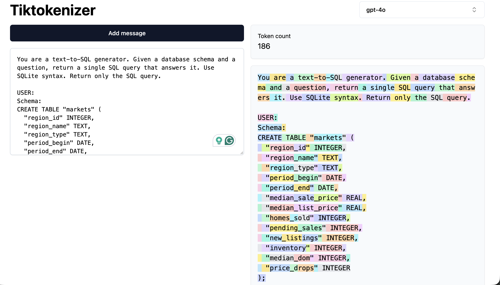
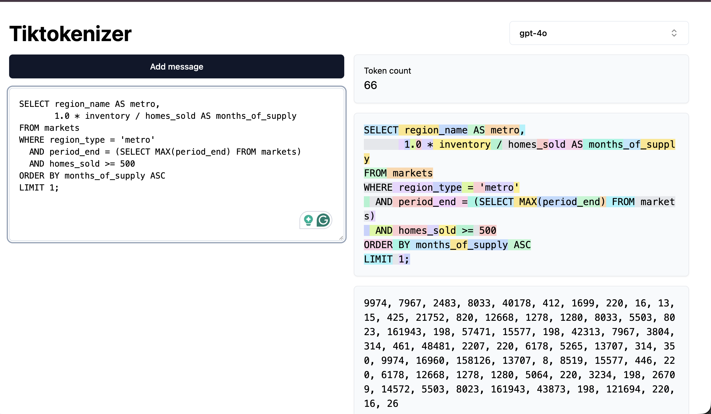
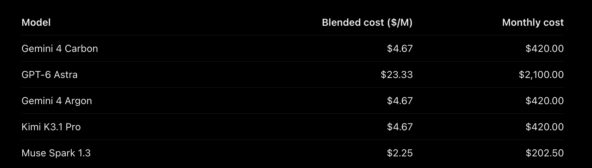
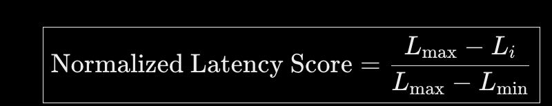
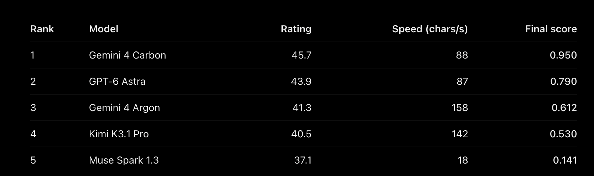

# Selecting the Right LLM for Your AI App
## Running Custom Model Evals (Text-to-SQL Case Study)

**Audience:** Students building / evaluating AI features  
**Case study:** Natural-language questions over housing market data (Redfin / Zillow style)  
**Goal:** Learn how to shortlist models, estimate cost & latency, and run custom evals — not just trust public leaderboards.

---

## 1. The product problem

Imagine a housing analytics app (inspired by Redfin / Zillow). Users ask questions in plain English, and the system must return the correct answer from a database.

**Example user questions**

- Which metros had the biggest price drop last year?
- Which state had the highest median sale price in 2024?
- What was the median sale price in Fremont for the most recent month?

**Underlying task:** Text-to-SQL → select the best model for this task.

### Important teaching note

We use **public research / market-tracker downloads**, not scraped listing pages.

| Source | Link |
|--------|------|
| Redfin Data Center | https://www.redfin.com/news/data-center/downloads/ |
| Zillow Research Data | https://www.zillow.com/research/data/ |

> **Do not scrape** live Redfin/Zillow listing pages.

---

## 2. Requirements before you pick a model

| Requirement | Decision for this case study | Why it matters |
|-------------|------------------------------|----------------|
| **Task** | Text-to-SQL | Execution accuracy matters |
| **Cost** | Ceiling ≈ **$1,000 / month** (confirm with PM) | Expensive models may be unaffordable |
| **Latency** | **≤ 3 seconds** | Reasoning models may be too slow |
| **Context** | Mostly **single-turn** | Schema + question is the prompt |
| **Deployment** | Open-source or closed-source | Privacy may force self-hosting |
| **Correctness** | **Critical** | Wrong SQL → bad PR |

---

## 3. The prompt you will evaluate

### SYSTEM

```text
You are a text-to-SQL generator. Given a database schema and a question,
return a single SQL query that answers it. Use SQLite syntax.
Return only the SQL query.
```

### USER

```text
Schema:
CREATE TABLE "markets" (
  "region_id" INTEGER,
  "region_name" TEXT,
  "region_type" TEXT,
  "period_begin" DATE,
  "period_end" DATE,
  "median_sale_price" REAL,
  "median_list_price" REAL,
  "homes_sold" INTEGER,
  "pending_sales" INTEGER,
  "new_listings" INTEGER,
  "inventory" INTEGER,
  "median_dom" INTEGER,
  "price_drops" INTEGER
);

Question: Which metro has the lowest months of supply among metros with at
least 500 homes sold in the latest month? Months of supply = active listings
divided by homes sold. Give the metro and the months of supply.

SQL:
```

### Example gold SQL

```sql
SELECT region_name AS metro,
       1.0 * inventory / homes_sold AS months_of_supply
FROM markets
WHERE region_type = 'metro'
  AND period_end = (SELECT MAX(period_end) FROM markets)
  AND homes_sold >= 500
ORDER BY months_of_supply ASC
LIMIT 1;
```

---

## 4. Estimate tokens

Go to [Tiktokenizer](https://tiktokenizer.vercel.app/) and count tokens for the input prompt and output SQL.



*Figure 1. Input prompt token count ≈ 186 (plan with ~200).*



*Figure 2. Output SQL token count ≈ 66 (plan with ~100).*

| Piece | Measured | Planning estimate |
|-------|----------|-------------------|
| Input prompt | ~186 | ~200 |
| Output SQL | ~66 | ~100 |
| **Total per request** | ~252 | **~300** |

**Traffic assumption**

- Questions per day: **10,000**
- Monthly requests: \(10{,}000 \times 30 = 300{,}000\)

---

## 5. Cost estimation

### 5.1 Simple cost formula

Example pricing from class notes: input **$8 / MTok**, output **$40 / MTok**.

\[
200 \times \frac{8}{10^6} + 100 \times \frac{40}{10^6} = 0.0016 + 0.004 = \$0.0056
\]


*Figure 3. Cost per request ≈ $0.0056*

\[
0.0056 \times 10{,}000 \times 30 = \$1{,}680
\]


*Figure 4. Estimated monthly cost ≈ $1,680 (above the $1,000 ceiling)*

### 5.2 Prompt caching

- [Claude pricing — prompt caching](https://platform.claude.com/docs/en/about-claude/pricing#prompt-caching)
- [Prompt caching guide](https://platform.claude.com/docs/en/build-with-claude/prompt-caching)
- Caching mainly helps **input** tokens

```python
import anthropic

client = anthropic.Anthropic()

response = client.messages.create(
    model="claude-sonnet-4-5",  # replace with the model under test
    max_tokens=1024,
    system=[{
        "type": "text",
        "text": "Long reusable system instructions + schema go here...",
        "cache_control": {"type": "ephemeral", "ttl": "1h"},
    }],
    messages=[{
        "role": "user",
        "content": "Which metro has the lowest months of supply ...?",
    }],
)

print(response.usage)
```

### 5.3 Blended cost shortcut

| Mix idea | Calculation | Blended $/MTok |
|----------|-------------|----------------|
| Heavier input share | \((4\times8 + 1\times40) / 5\) | **$14.4** |
| Closer to 2:1 in/out | \((2\times8 + 1\times40) / 5\) | **$11.2** |

\[
\frac{300 \times 11.2 \times 10{,}000 \times 30}{1{,}000{,}000} = \$1{,}008
\]

---

## 6. Shortlist 5 models

| Resource | Note |
|----------|------|
| [BIRD benchmark](https://bird-bench.github.io/) | Useful historically; can be outdated / custom-setup heavy |
| [LLM coding leaderboards](https://llm-stats.com/leaderboards/best-ai-for-coding) | Good for shortlisting, not a substitute for your eval |

**Shortlist cost sheet from your notes:**



*Figure 5. Example shortlist. GPT-6 Astra (~$2,100/mo) is over budget.*

We test the in-budget models on quality + latency next.

---

## 7. Latency calculation



*Figure 6. Normalized Latency Score*

\[
\text{FinalScore} = 0.9 \times \text{Rating} + 0.1 \times \text{LatencyScore (optional)}
\]



*Figure 7. Example ranking — Gemini 4 Carbon leads in this worked example.*

> Cheapest ≠ best. Quality still dominates (0.9 weight).

---

## 8. Custom model evals

For each model:

1. Load schema + golden questions  
2. Generate SQL  
3. Execute on SQLite  
4. Compare to gold result (**execution accuracy**)  
5. Log `match` / `mismatch` / `sql_error`  
6. Publish scoreboard  

---

## 9. Recommended workflow

1. Define constraints ($1k/mo, ≤3s, correctness critical)  
2. Freeze the prompt  
3. Measure tokens (Tiktokenizer)  
4. Estimate monthly cost → drop over-budget models  
5. Shortlist 5 models  
6. Build / use a golden dataset  
7. Run custom evals  
8. Apply quality + optional latency weighting  
9. Recommend 1 primary model + 1 backup  

---

## Appendix — Checklist

- [ ] Task defined as Text-to-SQL  
- [ ] Cost ceiling written down  
- [ ] Latency SLO written down  
- [ ] Prompt frozen  
- [ ] Tokens measured  
- [ ] 5 models shortlisted  
- [ ] Over-budget models removed  
- [ ] Golden set created  
- [ ] Execution-accuracy eval run  
- [ ] Final model chosen with rationale  

---

*Original screenshots from your notes are included as Figures 1–7.*
